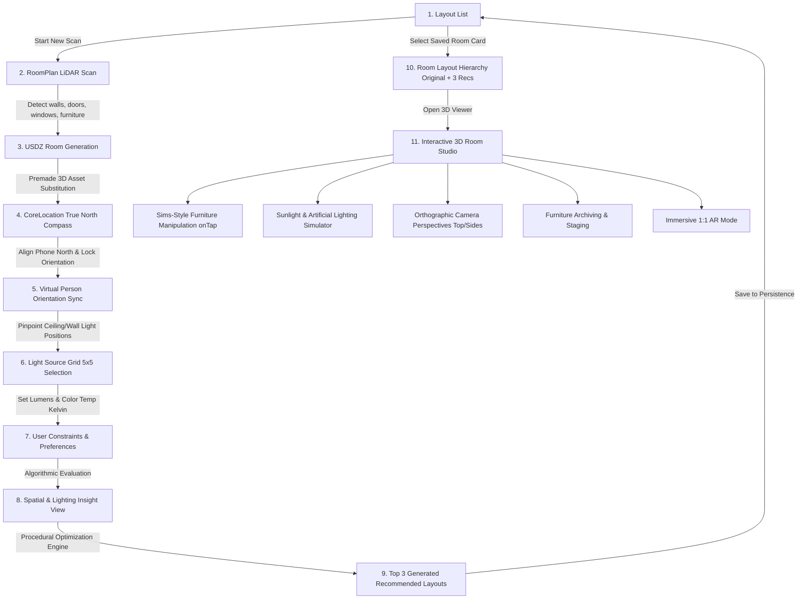

# Resign (Working Title) — 3D Room Rearranger & Sunlight Simulator

> An intelligent iOS spatial computing application that scans real-world rooms with **RoomPlan**, generates photorealistic 3D USDZ models, simulates natural daylight and artificial lighting physics, and generates scientifically optimized room layouts.

---

## 🌟 Product Vision

Resign helps homeowners, renters, and interior designers optimize furniture arrangements not just for aesthetics, but for **circadian lighting, spatial ergonomics, and airflow**. By combining LiDAR room scanning, geographic orientation (CoreLocation & true north alignment), and photometric rendering (RealityKit / SceneKit), Resign models real-world sunlight angles throughout the day and generates mathematically backed layout recommendations.

---

## 🗺️ Complete End-to-End User Flow



### Detailed Step-by-Step Flow:

1. **Saved Layouts Dashboard**:
   - Main entry displaying cards of saved scanned rooms. Empty state guides the user to start their first LiDAR room scan.
2. **RoomPlan LiDAR Scanning**:
   - Uses Apple's `RoomPlan` framework (`RoomCaptureView` / `RoomCaptureSession`) with real-time feedback to detect walls, doors, windows, openings, and categorized furniture objects (beds, desks, chairs, sofas, tables, storage).
3. **Model & USDZ Asset Generation**:
   - Translates detected bounding boxes and spatial dimensions into a unified USDZ 3D room hierarchy, automatically substituting generic wireframes with curated 3D model assets.
4. **Geographic True North Orientation**:
   - Prompts the user with a real-time compass interface powered by `CoreLocation` and device magnetometers (`CLLocationManager`).
5. **Orientation Lock & Virtual Avatar Sync**:
   - When pointed north for 2 seconds, the orientation locks. The user then rotates a virtual avatar/point-of-view marker to align the 3D room coordinate system with the exact physical direction they are looking.
6. **Artificial Light Source Grid Mapping**:
   - User pinpoints existing ceiling and wall light sources on a spatial grid (e.g. 5×5 ceiling projection).
7. **Photometric Calibration**:
   - Allows users to specify luminosity (lux / lumens) and correlated color temperature (Kelvin: warm 2700K to daylight 6500K) for each fixture.
8. **User Needs & Pain Point Intake**:
   - Interactive intake questionnaire (e.g., "desk lacks natural sunlight", "bed faces door directly", "cramped walking path", "glare on monitor").
9. **Automated Diagnostic & Insight Report**:
   - Evaluates the current configuration against spatial heuristics (Feng Shui command position, circulation clearances >= 36 inches, window glare vectors, task lighting coverage).
10. **Algorithmic Layout Generator (Top 3 Recommendations)**:
    - Generates 3 mathematically and theoretically distinct layouts:
      - *Layout A (Optimal Sunlight & Circadian Productivity)*
      - *Layout B (Spacious Circulation & Flow)*
      - *Layout C (Ergonomic / Restful Sanctuary)*
11. **Multi-Layout Management**:
    - Scanned rooms persist in SwiftData. Selecting a room opens a sub-list containing the *Original Scan* and the *3 Recommended Layouts*.
12. **Interactive 3D Studio**:
    - Free orbit, pan, and pinch-to-zoom 3D viewport.
    - **Sims-Style Object Interaction**: Tapping any furniture highlights it and spawns radial contextual action buttons (Rotate, Slide along floor plane, Swap asset, Archive/Hide).
    - **Lighting Simulator**: Toggle artificial lights ON/OFF and scrub a 24-hour time-of-day slider to observe dynamic directional sunlight shadows cast through detected windows based on true solar ephemeris calculations.
    - **View Angle Presets**: Instant camera snapping (Top-Down 2D floor plan, Left, Right, Front, Back).
    - **Furniture Archiving**: Temporarily hide or store furniture in an "Inventory Bin" to visualize decluttered or minimalist layouts.
    - **1:1 Immersive AR View**: Drops the user into the re-arranged 3D render at scale, letting them physically walk through the proposed room redesign in augmented reality using ARKit.

---

## 🏗️ Technical Architecture

- **UI Layer**: SwiftUI with NavigationStack and modular sheets.
- **3D & Spatial Engine**: RealityKit / SceneKit, USDZ asset pipeline, and ARKit.
- **Computer Vision & Scanning**: Apple `RoomPlan` (`RoomCaptureSession`, `CapturedRoom`).
- **Sensors & Location**: `CoreLocation` (`CLLocationManager`), Magnetometer / Heading.
- **Persistence**: SwiftData (`@Model`, `ModelContainer`) with offline-first local storage.
- **Calculations & Ephemeris**: Astronomical solar position algorithms (Sun azimuth & elevation based on device coordinates and time of day).

### Codebase Organization (Vertical Feature Slices)
```text
Resign/
├── App/         // Lifecycle & type-safe Navigation router (AppRoute)
├── Features/    // Vertical slices: Dashboard, RoomScan, Orientation, LightingSetup, Insights, Studio3D, ARWalkthrough
├── Core/        // Models, Algorithms, and Spatial helpers (Zero UI, 100% pure)
└── Services/    // Hardware & system providers (Location, SwiftData repository)
```

---

## 🗺️ Project Roadmap & Implementation Tracking

Track real-time engineering milestones, algorithm implementations, and feature phases in [ROADMAP.md](ROADMAP.md).

---

## 📚 Architectural Documentation

- [Architecture Blueprint](docs/ARCHITECTURE.md)
- [Mock Room USDZ Specification](docs/MOCK_USDZ_SPEC.md) *(Standard reference room for light simulation and spatial tests)*
- [Architecture Decision Records (ADRs)](docs/adr/README.md)
- [Agent Flight Simulator & Prompt Recipes](docs/RECIPES.md)
- [Living Changelog](CHANGELOG.md)

## Current mock daylight simulation

The new RealityKit studio calculates sun direction from date, location, time zone and room heading. The reference scene uses Jakarta on 24 October 2026 (WIB), with its window facing east. Direct sun enters only when the sun is above the horizon and in front of that window; diffuse sky illumination remains during daylight and fades through twilight. Source lighting and shadows are controlled separately from artificial fixtures. The mock context is explicit and is not yet connected to saved room coordinates or user-editable geographic controls. See [ADR 0015](docs/adr/0015-geographic-mock-daylight.md) for conventions and limitations.

Lighting simulation uses the `Light` records saved on the selected `Layout`. The ceiling-grid coordinates map to the mock room's ceiling, while each saved fixture supplies its own brightness, color temperature, and on/off state. The simulation switch is a temporary master control; it does not rewrite saved fixtures. See [ADR 0018](docs/adr/0018-layout-lights-in-room-simulation.md).

Direct sunlight uses shadows on both simulator and physical device so the loaded window opening and mullion shape the light patch. A gradual spotlight falloff softens the edge, while a wider cone leaves the aperture geometry to define the footprint. Optional diffuse-sky and fixture shadows remain disabled by default in the simulator. See [ADR 0017](docs/adr/0017-window-shaped-sunlight.md), which amends the fallback in [ADR 0016](docs/adr/0016-simulator-daylight-fallback.md).

The studio overrides automatic image-based environment illumination so it cannot wash out daylight changes. Direct sun exposure compensates for source distance, preserving brightness when the beam is moved farther away to reduce divergence.

A soft, broad window fill and an interior sky-bounce source approximate indirect illumination. The diffuse fill remains active at noon even after the sun passes behind the east-facing facade, so the room stays daylit without a direct sun patch; the approximation turns off at night.
