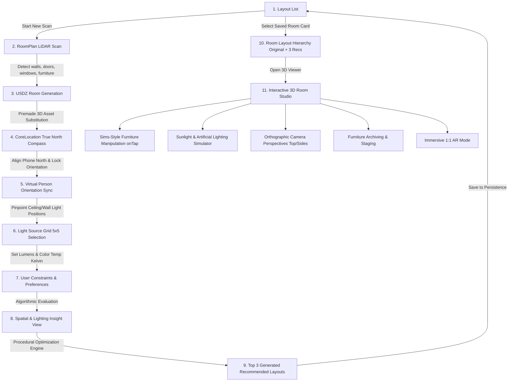

# Resign (Working Title) — 3D Room Rearranger & Sunlight Simulator

> An intelligent iOS spatial computing application that scans real-world rooms with **RoomPlan**, generates photorealistic 3D USDZ models, simulates natural daylight and artificial lighting physics, and generates scientifically optimized room layouts.

---

## 🌟 Product Vision

Resign helps homeowners, renters, and interior designers optimize furniture arrangements not just for aesthetics, but for **circadian lighting, spatial ergonomics, and airflow**. By combining LiDAR room scanning, geographic orientation (CoreLocation & true north alignment), and photometric rendering (RealityKit / SceneKit), Resign models real-world sunlight angles throughout the day and generates mathematically backed layout recommendations.

---

## 🗺️ Complete End-to-End User Flow



### Detailed Step-by-Step Flow:

1. **Saved Layouts Dashboard**:
   - Main entry displaying cards of saved scanned rooms. Empty state guides the user to start their first LiDAR room scan.
2. **RoomPlan LiDAR Scanning**:
   - Uses Apple's `RoomPlan` framework (`RoomCaptureView` / `RoomCaptureSession`) with real-time feedback to detect walls, doors, windows, openings, and categorized furniture objects (beds, desks, chairs, sofas, tables, storage).
3. **Model & USDZ Asset Generation**:
   - Translates detected bounding boxes and spatial dimensions into a unified USDZ 3D room hierarchy, automatically substituting generic wireframes with curated 3D model assets.
4. **Geographic True North Orientation**:
   - After scanning, prompts the user with a real-time compass powered by `CoreLocation`; a smoothed heading must stay within 2° of 000° for 2 seconds to auto-lock. Sensor accuracy remains visible as guidance.
5. **Orientation Lock & Virtual Avatar Sync**:
   - The plan shows the scanned walls, furniture, windows, and doors in the scan's local frame. After lock, the user rotates a highlighted centered person marker to show where north lies in the room; saving stores the room's clockwise north bearing before continuing to light placement.
6. **Artificial Light Source Grid Mapping**:
   - User pinpoints existing ceiling and wall light sources on a spatial grid (e.g. 5×5 ceiling projection).
7. **Photometric Calibration**:
   - Allows users to specify luminosity (lux / lumens) and correlated color temperature (Kelvin: warm 2700K to daylight 6500K) for each fixture.
8. **User Needs & Pain Point Intake**:
   - Interactive intake questionnaire (e.g., "desk lacks natural sunlight", "bed faces door directly", "cramped walking path", "glare on monitor").
9. **Automated Diagnostic & Insight Report**:
   - Evaluates the current configuration against spatial heuristics (Feng Shui command position, circulation clearances >= 36 inches, window glare vectors, task lighting coverage).
10. **Algorithmic Layout Generator (Top 3 Recommendations)**:
    - Generates 3 mathematically and theoretically distinct layouts:
      - *Layout A (Optimal Sunlight & Circadian Productivity)*
      - *Layout B (Spacious Circulation & Flow)*
      - *Layout C (Ergonomic / Restful Sanctuary)*
11. **Multi-Layout Management**:
    - Scanned rooms persist in SwiftData. Selecting a room opens a sub-list containing the *Original Scan* and the *3 Recommended Layouts*.
12. **Interactive 3D Studio**:
    - Free orbit, pan, and pinch-to-zoom 3D viewport.
    - **Sims-Style Object Interaction**: Tapping any furniture highlights it and spawns radial contextual action buttons (Rotate, Slide along floor plane, Swap asset, Archive/Hide).
    - **Lighting Simulator**: Toggle artificial lights ON/OFF and scrub a 24-hour time-of-day slider to observe dynamic directional sunlight shadows cast through detected windows based on true solar ephemeris calculations.
    - **View Angle Presets**: Instant camera snapping (Top-Down 2D floor plan, Left, Right, Front, Back).
    - **Furniture Archiving**: Temporarily hide or store furniture in an "Inventory Bin" to visualize decluttered or minimalist layouts.
    - **1:1 Immersive AR View**: Drops the user into the re-arranged 3D render at scale, letting them physically walk through the proposed room redesign in augmented reality using ARKit.

The Dashboard starts the room scanner in its creation flow. After scan review, Set Room North calibrates the scanned room before Add Your Light Source. Saving lights returns to the Dashboard; opening that saved layout in Studio 3D uses its compass bearing and fixtures.

---

## 🏗️ Technical Architecture

- **UI Layer**: SwiftUI with NavigationStack and modular sheets.
- **3D & Spatial Engine**: RealityKit / SceneKit, USDZ asset pipeline, and ARKit.
- **Computer Vision & Scanning**: Apple `RoomPlan` (`RoomCaptureSession`, `CapturedRoom`).
- **Sensors & Location**: `CoreLocation` (`CLLocationManager`), Magnetometer / Heading.
- **Persistence**: SwiftData (`@Model`, `ModelContainer`) with offline-first local storage.
- **Calculations & Ephemeris**: Astronomical solar position algorithms (Sun azimuth & elevation based on device coordinates and time of day).

### Codebase Organization (Vertical Feature Slices)
```text
Resign/
├── App/         // Lifecycle & type-safe Navigation router (AppRoute)
├── Features/    // Vertical slices: Dashboard, RoomScan, Orientation, LightingSetup, Insights, Studio3D, ARWalkthrough
├── Core/        // Models, Algorithms, and Spatial helpers (Zero UI, 100% pure)
└── Services/    // Hardware & system providers (Location, SwiftData repository)
```

---

## 🗺️ Project Roadmap & Implementation Tracking

Track real-time engineering milestones, algorithm implementations, and feature phases in [ROADMAP.md](ROADMAP.md).

---

## 📚 Architectural Documentation

- [Architecture Blueprint](docs/ARCHITECTURE.md)
- [Mock Room USDZ Specification](docs/MOCK_USDZ_SPEC.md) *(Standard reference room for light simulation and spatial tests)*
- [Architecture Decision Records (ADRs)](docs/adr/README.md)
- [Agent Flight Simulator & Prompt Recipes](docs/RECIPES.md)
- [Living Changelog](CHANGELOG.md)

## Scanned-layout lighting simulation

Studio 3D loads the selected layout's exported USDZ room and saved active furniture. The room, windows, and furniture use the same scan center, wall orientation, and floor level as the orientation plan. Camera framing follows the loaded room bounds. If its exported asset is missing, the renderer reconstructs the saved walls and opening apertures; rooms without wall metadata use their rectangular dimensions. The bundled bedroom remains the reference for previews without a selected layout. See [ADR 0023](docs/adr/0023-render-selected-scanned-layout-lighting.md).

Add Light Source and Configure Ceiling Lights show the selected scan's plan. Placement points adapt to the captured wall bounds and room proportions, with roughly 0.85-meter spacing and fewer points where needed to keep touch targets usable. The plan fills more of the screen, and placing a bulb hides only dots directly beneath its marker so adjacent positions remain available. Closed scanned perimeters exclude points outside the room, including the missing area of an L-shaped plan; incomplete traces use rectangular fallback. Saved fixtures retain exact positions independently of candidate count, and simulation uses the same plan coordinates. Rooms without wall metadata use saved rectangular dimensions. Reopening configuration copies saved fixtures into transient drafts, preserving their identity, grid position, brightness, color temperature, and on/off state. Save updates existing fixtures, adds new ones, and deletes removed ones, including the last fixture; repeated saves do not duplicate lights. Leaving without saving discards draft edits. Legacy five-by-five positions remain compatible. See [ADR 0024](docs/adr/0024-adaptive-ceiling-light-placement.md). Fixture height stays below the room ceiling. The simulation switch acts as a temporary master control and does not rewrite saved fixture records.

Artificial fixtures use an eightfold render exposure gain and a soft fill at half the direct-light output, slightly below the ceiling, to make surfaces more readable in the dark preview environment. This compensates visually for missing indirect illumination; saved lumen values, relative brightness, color temperature, and on/off controls remain unchanged. It is not a measured lux calibration.

Natural light follows each detected window's position, aperture size, and facade direction combined with the saved north bearing. Opposite facades admit direct sun at different times; diffuse window fill and one shared interior bounce remain active during daylight. A scan without detected windows receives no window daylight. The source caption lists the corresponding window directions. Saved wall segments provide aperture panels when a native parametric USDZ contains solid walls behind its window meshes.

The solar calculation still uses the explicit Jakarta reference site on 24 October 2026 (WIB). Geographic site/date controls and measured illuminance calibration are outside the current flow. Soft cone edges, distance compensation, and indirect bounce remain visual approximations. Optional secondary shadows remain disabled by default in the simulator; direct beam shadows shape the patch through the saved window aperture. See [ADR 0017](docs/adr/0017-window-shaped-sunlight.md), [ADR 0021](docs/adr/0021-room-north-alignment.md), and [ADR 0022](docs/adr/0022-persist-scanned-room-plan-frame.md).
