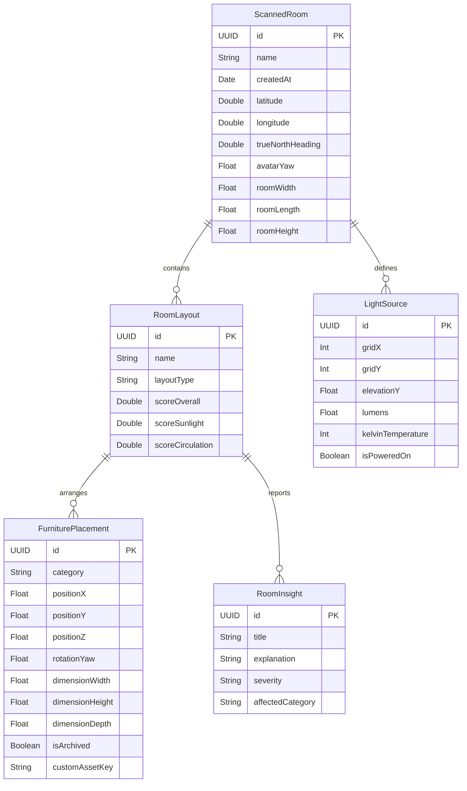

# Architecture Blueprint — Resign

> Technical specification, domain schema, spatial algorithms, and architectural decisions for **Resign** (3D Room Rearranger & Sunlight Simulator).

---

## 1. Executive Summary & Design Decisions

Through the comprehensive `/grill-me` architectural design review, all foundational technology and user experience branches have been established:

| Domain | Decision | Architectural Rationale |
| :--- | :--- | :--- |
| **3D & Spatial Engine** | **RealityKit (`RealityView`)** | Modern Apple spatial standard (iOS 17+), native USDZ rendering, physically based shadows, seamless ARKit anchoring. |
| **Hardware Strategy** | **Strict LiDAR Requirement** | RoomPlan LiDAR is strictly required. Non-LiDAR devices are greeted with a dedicated hardware requirement screen. |
| **Asset Pipeline** | **Bundled Curated USDZ Catalog** | App bundle contains stylized, optimized USDZ models (bed, desk, sofa, etc.) scaled non-uniformly to match RoomPlan bounding boxes. |
| **Natural Sunlight Engine**| **NOAA Solar Ephemeris Algorithm**| Real-world astronomical sun vector calculations (azimuth & elevation) using device latitude, longitude, and 24-hour time of day. |
| **Artificial Light Mapping**| **2D Interactive Ceiling Grid (5×5)**| Touch-enabled top-down grid overlay on the room floorplan for dropping fixtures with Lumens (0–2000 lm) and Kelvin (2200K–6500K) controls. |
| **Layout Generator** | **Deterministic Swift Rules + LLM** | Mathematical clearance corridors (>= 90cm), window glare vectors, and Feng Shui command positions generate 3 layouts; LLM provides natural language design rationales. |
| **3D Object Interaction** | **Sims-Style Radial Menu + Floor Drag**| Tapping furniture spawns floating action pills (Rotate, Slide, Archive); dragging is strictly constrained to the floor plane ($Y=0$) with boundary collision snapping. |
| **Augmented Reality Mode** | **1:1 Full-Scale Physical Immersion** | Virtual furniture is superimposed directly onto the user's actual room at true 1:1 scale for real-world physical walkthroughs. |
| **Data Persistence** | **Hierarchical SwiftData Schema** | `ScannedRoom` owns multiple `RoomLayout` revisions, each with independent `FurniturePlacement` and `LightSource` records. |

---

## 2. System Architecture Diagram

```
+-----------------------------------------------------------------------------------+
|                                 SwiftUI UI LAYER                                   |
|   - RoomListView (Dashboard)           - RoomPlanScanView (LiDAR Capture)         |
|   - CompassAlignmentView (True North)   - CeilingLightGridView (5x5 Light Mapper)  |
|   - InsightReportView (Diagnostics)     - RoomStudioView (Interactive 3D RealityKit)|
|   - ARWalkthroughView (1:1 Immersion)   - LayoutComparisonView (Original vs Recs) |
+-----------------------------------------------------------------------------------+
                                         |
                                         v
+-----------------------------------------------------------------------------------+
|                            DOMAIN ENGINES (Pure Swift)                            |
|                                                                                   |
|  [NOAA Solar Ephemeris Engine]          [Spatial Heuristic Optimizer Engine]       |
|  - Inputs: Lat, Lon, Date, Time, Heading - Circulation Corridors (>= 90cm)        |
|  - Outputs: Azimuth & Elevation Angles  - Window Glare Vector Analysis             |
|  - DirectionalLightEntity Vector         - Feng Shui Command Position Scoring      |
|                                          - Generates 3 Mathematically Distinct Recs|
+-----------------------------------------------------------------------------------+
                                         |
                                         v
+-----------------------------------------------------------------------------------+
|                        REALITYKIT & ASSET SUBSYSTEM                               |
|  - RoomPlan USDZ Importer               - Bounding Box Asset Scaler               |
|  - RealityView Gesture Recognizers      - Floor Plane Drag Constraint (Y=0)       |
|  - Directional Sun Entity + PointLights - Orthographic Camera Snapping (5 Views)  |
|  - ARKit 1:1 World Tracking Session     - Furniture Inventory Archive Bin         |
+-----------------------------------------------------------------------------------+
                                         |
                                         v
+-----------------------------------------------------------------------------------+
|                           SWIFTDATA PERSISTENCE LAYER                             |
|  - ScannedRoom (Metadata, Location, Heading, Dimensions, Layouts, LightSources)   |
|  - RoomLayout (LayoutType, Placements, Insights, GeneratedDate)                   |
|  - FurniturePlacement (Category, X/Y/Z, Yaw, Dimensions, IsArchived, AssetKey)   |
|  - LightSource (GridX, GridY, Elevation, Lumens, Kelvin, IsActive)                |
+-----------------------------------------------------------------------------------+
```

---

## 3. Data Schema & Models



---

## 4. Key Spatial & Physical Algorithms

### A. NOAA Astronomical Solar Ephemeris Engine
Calculates the exact sun vector in room coordinate space:
1. **Julian Day Calculation**: Converts the specified local time and date to Universal Time (UTC) and computes the fractional Julian day.
2. **Solar Declination & Equation of Time**: Solves for the sun's celestial position relative to Earth's axial tilt.
3. **Local Solar Time**: Adjusts clock time by longitude offset ($4 \text{ min/degree}$) and the equation of time.
4. **Solar Zenith & Azimuth**:
   $$\cos(\theta_z) = \sin(\phi)\sin(\delta) + \cos(\phi)\cos(\delta)\cos(h)$$
   where $\phi$ is latitude, $\delta$ is solar declination, and $h$ is hour angle.
5. **Room Coordinate Transform**: Rotates the real-world solar azimuth by the room's true-north alignment heading:
   $$\theta_{\text{room}} = \theta_{\text{solar}} - \theta_{\text{true\_north}} - \theta_{\text{avatar\_offset}}$$
6. **RealityKit DirectionalLightEntity**: Directly updates the sunlight direction and color temperature (Kelvin to RGB gradient) to cast physically accurate window shadows in real time.

### B. Spatial Clearance & Layout Scoring Engine
Evaluates layouts across 3 objective mathematical dimensions:
1. **Circulation Clearance Score ($S_{\text{circ}}$)**:
   - Constructs a 2D navigation grid of the room floor.
   - Calculates path width between doors, windows, and furniture edges.
   - Penalizes any primary walking corridor narrower than **90 cm (36 inches)**.
2. **Daylight & Glare Optimization Score ($S_{\text{light}}$)**:
   - Desks: Rewards placement where natural light arrives from the side ($70^\circ - 110^\circ$ to monitor screen vector) while penalizing direct window backlighting (glare).
   - Seating/Reading: Rewards positioning within the direct solar illumination polygon during daylight hours.
3. **Command Position & Ergonomics Score ($S_{\text{ergo}}$)**:
   - Beds/Desks: Rewards placement where the occupant can see the primary door without being directly in line with the doorway (Feng Shui / psychological comfort).
   - Headboards: Must anchor firmly against solid walls rather than floating in open circulation paths or blocking windows.

### C. The 3 Generated Recommendations:
- **Layout 1: Circadian Productivity**: Maximizes natural sunlight on active work/study zones (desks, reading nooks) with zero screen glare.
- **Layout 2: Open Flow & Circulation**: Maximizes central continuous floor space and ensures all entry/exit corridors exceed 100 cm.
- **Layout 3: Restful Sanctuary**: Places beds and relaxation zones in maximum shadow zones shielded from direct door sightlines and outside window drafts.
