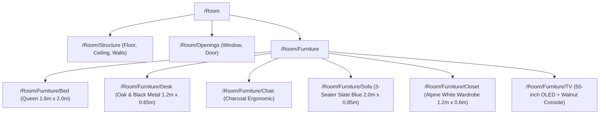

# Mock Room USDZ Asset Specification (`MockRoom.usdz`)

This document defines the spatial coordinate frame, geometry, material parameters, and scene hierarchy of the standalone reference mock room asset generated for **Resign**.

Teammates working on the **Sunlight & Artificial Lighting Simulator**, **Spatial Clearance Engine**, **Layout Optimizer**, or **3D Studio View** can use this asset immediately without needing a physical LiDAR room scan.

---

## 📍 File Locations & Generation

- **Packaged USDZ Asset**: `Resign/Resources/MockRoom.usdz` *(bundled into the app binary)*
- **Source USDA Scene**: `Resign/Resources/MockRoom.usda` *(human-readable ASCII USD)*
- **Automated Generator Script**: `scripts/generate-mock-usdz.py` *(re-run anytime with `python3 scripts/generate-mock-usdz.py`)*

---

## 📐 Spatial System & Room Dimensions

| Property | Value | Notes |
| :--- | :--- | :--- |
| **Units** | Meters (`metersPerUnit = 1.0`) | Standard iOS RealityKit / ARKit metric scale |
| **Up Axis** | `Y` (`upAxis = "Y"`) | $+Y$ is Up, $+X$ is East, $+Z$ is South |
| **Room Width ($X$)** | **$5.00\text{ m}$** | Spans $x \in [-2.50, +2.50]$ |
| **Room Length ($Z$)** | **$4.20\text{ m}$** | Spans $z \in [-2.10, +2.10]$ |
| **Ceiling Height ($Y$)** | **$2.60\text{ m}$** | Floor at $y = 0.00$, Ceiling at $y = 2.60$ |
| **Floor Area** | **$21.0\text{ m}^2$** | Realistic master bedroom / studio apartment |
| **Wall Thickness** | **$0.10\text{ m}$** | Physical wall geometry enclosing interior |

---

## 🚪 Openings (Critical for Light & Circulation Simulation)

### 1. East Window (`/Room/Openings/Window`)
- **Wall Location**: East Wall ($+X = 2.50\text{ m}$ to $2.60\text{ m}$).
- **Dimensions**: Width $1.60\text{ m}$ ($z \in [-0.80, +0.80]$), Sill height $0.85\text{ m}$, Top height $2.05\text{ m}$ ($y \in [0.85, 2.05]$).
- **Physical Structure**: Outer dark aluminum frame, vertical center mullion, and transparent glass pane (`/Room/Openings/Window/Glass`).
- **PBR Glass**: Translucent architectural glass (`opacity: 0.15`, `roughness: 0.02`, `ior: 1.52`).
- **Lighting Simulator Use Case**:
  - Direct morning sunlight (azimuth $70^\circ$–$110^\circ$, elevation $15^\circ$–$50^\circ$) streams directly through this window.
  - Realistic window frame shadows and sunbeam sweeps project across the floor, bed, and desk.

### 2. South Entry Door (`/Room/Openings/Door`)
- **Wall Location**: South Wall ($+Z = 2.10\text{ m}$ to $2.20\text{ m}$).
- **Dimensions**: Width $0.90\text{ m}$ ($x \in [-1.95, -1.05]$), Height $2.10\text{ m}$ ($y \in [0.00, 2.10]$).
- **Physical Structure**: Casing frame, ash timber slab (`/Room/Openings/Door/Panel`), and brushed stainless steel lever handle at $y = 1.00\text{ m}$.
- **Clearance Engine Use Case**:
  - Tests doorway ingress/egress clearance vectors ($>0.9\text{ m}$ walking corridor into the room).

---

## 🛋️ Furniture Inventory & Bounding Volumes

All furniture pieces are individually named subcomponent prims under `/Room/Furniture/` with exact physical dimensions and PBR materials:



### Detailed Furniture Specifications:

| Prim Name | Type / Category | Bounding Box Center $(X, Y, Z)$ | Bounding Extents $(W, H, D)$ | Key Components & Finishes |
| :--- | :--- | :--- | :--- | :--- |
| `Bed` | `"bed"` | $(-1.30, 0.53, -1.04)$ | $1.64\text{ m} \times 1.05\text{ m} \times 2.08\text{ m}$ | Walnut platform base, cream linen mattress, upholstered gray headboard against North wall, 2 pillows, navy duvet runner. |
| `Desk` | `"desk"` | $(+2.13, 0.38, -1.20)$ | $0.65\text{ m} \times 0.75\text{ m} \times 1.20\text{ m}$ | Natural oak tabletop ($0.04\text{ m}$ thick) at height $0.75\text{ m}$, 4 matte black metal legs. Placed near East window. |
| `Chair` | `"chair"` | $(+1.41, 0.44, -1.20)$ | $0.46\text{ m} \times 0.88\text{ m} \times 0.44\text{ m}$ | Charcoal fabric seat ($y = 0.45\text{ m}$) & curved backrest, 4 black steel legs, facing East desk. |
| `Sofa` | `"sofa"` | $(+1.20, 0.41, +1.08)$ | $2.00\text{ m} \times 0.82\text{ m} \times 0.85\text{ m}$ | 3-seater slate blue fabric base, rear backrest, left & right armrests, 2 almond beige accent cushions. Faces North TV. |
| `Closet` | `"closet"` | $(-2.16, 1.05, +1.20)$ | $0.64\text{ m} \times 2.10\text{ m} \times 1.20\text{ m}$ | Modern matte alpine white wardrobe body against West wall, 2 brushed brass vertical handles facing $+X$. |
| `TV` | `"tv"` | $(+1.20, 0.64, -1.83)$ | $1.40\text{ m} \times 1.28\text{ m} \times 0.38\text{ m}$ | Dark walnut media credenza ($0.46\text{ m}$ high), pedestal mount, 55-inch OLED glossy screen with slim bezel. |

---

## 💻 Swift / RealityKit Usage Guide

### Loading in RealityKit
```swift
import RealityKit
import Foundation

// 1. Locate MockRoom in the app bundle
guard let url = Bundle.main.url(forResource: "MockRoom", withExtension: "usdz") else {
    fatalError("MockRoom.usdz missing from bundle")
}

// 2. Load the USDZ hierarchy into an Entity
let roomEntity = try await Entity(contentsOf: url)

// 3. Query specific openings or furniture
if let window = roomEntity.findEntity(named: "Window") {
    let windowBounds = window.visualBounds(relativeTo: roomEntity)
    print("Window Center: \(windowBounds.center), Extents: \(windowBounds.extents)")
}

if let bed = roomEntity.findEntity(named: "Bed") {
    let bedBounds = bed.visualBounds(relativeTo: roomEntity)
    print("Bed Position: \(bedBounds.center)")
}
```

### Loading in Unit Tests / ModelIO
```swift
import ModelIO

let url = Bundle.main.url(forResource: "MockRoom", withExtension: "usdz")!
let asset = MDLAsset(url: url)
print("Loaded top-level meshes: \(asset.count)")
```

---

## ☀️ Lighting Simulation Reference Vectors

- **East Window Normal**: `(1.0, 0.0, 0.0)` — Direct east sun strikes window between azimuth $060^\circ$ and $120^\circ$.
- **Sunrise Scenario**: At azimuth $090^\circ$ (due East) and elevation $25^\circ$:
  - Light ray vector: $\mathbf{L} = (-\cos(25^\circ), -\sin(25^\circ), 0.0) \approx (-0.906, -0.423, 0.0)$.
  - Light projects through the East window, hits the desk top, casts shadows of chair and desk legs westward toward the bed, and illuminates the center oak parquet floor.
- **Afternoon / Sunset Scenario**: Sun moves to the West/Southwest (azimuth $>180^\circ$); direct light is blocked by the solid West wall, simulating realistic twilight interior occlusion.
