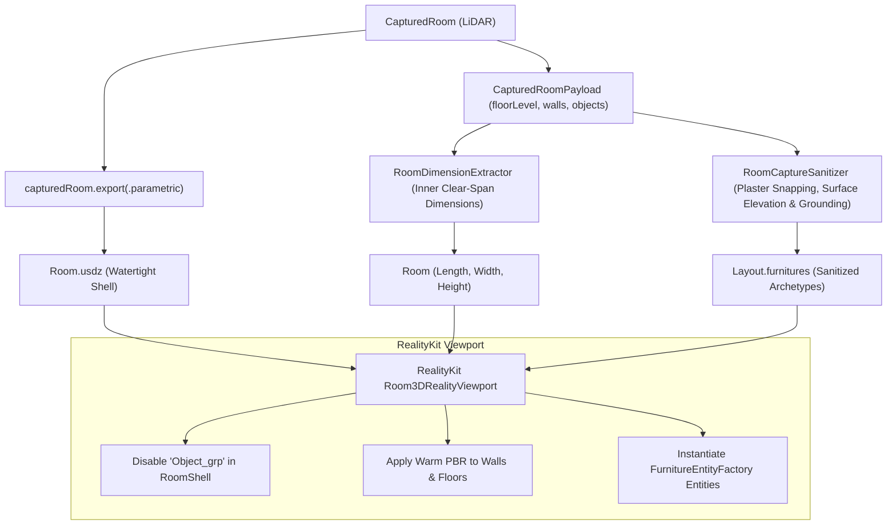

# ADR 0010: Hybrid Native Parametric Room Shell and Sanitized Furniture Pipeline

* Status: accepted
* Date: 2026-10-22
* Deciders: Lead Developer, Antigravity Agent
* Supersedes: ADR 0008 (Procedural USD Mesh Generation)

## Context and Problem Statement

Resign previously implemented custom procedural USD mesh generation (`ProceduralRoomUSDZGenerator`) to synthesize OpenUSD `.usda` files from RoomPlan surface payloads. When evaluated against Apple's native RoomPlan export (`capturedRoom.export(to:exportOptions:.parametric)`), procedural string synthesis exhibited critical visual flaws:
1. **Apertures & Wall Penetrations**: Procedural generation created solid 6-sided wall prisms that occluded door and window openings, pasting flat quads that induced severe z-fighting. In contrast, Apple's native exporter subdivides wall meshes around openings into watertight architectural triangles.
2. **Wall Miters & Light Leaking**: Disjoint rectangular prisms placed at wall centerlines either collided at corners (flickering surfaces) or left open seams. Apple's native export computes exact geometric miter angles where wall planes meet.
3. **Floor Polygon Drift**: Approximating floor boundaries with ear-clipping on wall base heuristics drifted from actual wall baselines. Apple's native export provides an exact triangulated floor polygon derived directly from LiDAR surface intersections.
4. **Duplication of Platform Strengths**: Re-implementing CAD polygonal booleans and architectural meshing in Swift duplicated thousands of hours of Apple engineering, while degrading visual quality.

Conversely, Apple's native export has one major weakness: **furniture representation**. RoomPlan exports crude, hollow wireframe bounding boxes (`Bed0.usda`, `Chair0.usda`), often floating above the floor or clipping into drywall.

## Decision Drivers

* **Watertight Architectural Precision**: Deliver CAD-grade walls, accurate door and window cutouts, and watertight floor polygons without rendering artifacts.
* **Preserve Interior Intelligence**: Maintain Resign's core value—oriented bounding box (OBB) room dimensions, drywall plaster snapping ($T/2 = 0.05\,\text{m}$), floor grounding ($Y = \text{floorLevel}$), and discrete archetype categorization.
* **Apple QuickLook & RealityKit Interoperability**: Produce standard `.usdz` archives natively viewable in iOS QuickLook and RealityKit with zero conversion lag.
* **Maintainable Codebase**: Eliminate custom procedural USD string formatting from the codebase.

## Considered Options

1. **Option 1: Fix and Refine Procedural USD Meshing**:
   Attempt to build 3D CSG boolean operations, miter cuts, and UV coordinate generators in Swift.
   * *Rejected*: Extreme complexity, high risk of edge-case bugs in non-standard rooms, and massive performance overhead.
2. **Option 2: 100% Stock Apple RoomPlan Export**:
   Rely entirely on `capturedRoom.export(to:exportOptions:.parametric)` without custom furniture logic.
   * *Rejected*: RoomPlan furniture items remain crude wireframe boxes with no realistic materials, no plaster offset, and no archetype substitution.
3. **Option 3: Hybrid Native Parametric Shell + Sanitized Furniture Engine (Chosen)**:
   - Export Apple's native CAD-grade parametric room shell directly via `capturedRoom.export(to: url, exportOptions: .parametric)`.
   - Use Resign's pure Swift `RoomDimensionExtractor` and `RoomCaptureSanitizer` to extract inner clear-span room dimensions, ground floor furniture to the captured floor level, preserve elevated surface items (such as standing televisions on media consoles and floating wall shelves), snap items flush with plaster walls, and classify archetypes.
   - In RealityKit, load the native `.usdz`, disable Apple's crude wireframe `Object_grp`, and instantiate Resign's sanitized 3D furniture models.
   - Apply warm architectural PBR finishes (natural oak flooring, matte plaster walls) dynamically at runtime.

## Decision Outcome

Chosen option: **Option 3: Hybrid Native Parametric Shell + Sanitized Furniture Engine**.

### Architecture & Data Flow

### Consequences

* **Immediate Quality Jump**: Rooms render with watertight mitered walls, pre-cut door openings, framed windows, and flush floors.
* **Preserved Domain Precision**: Bounding dimensions and furniture placement remain mathematically grounded via Resign's OBB and plaster sanitizer.
* **Deprecation of Procedural USD Generator**: `ProceduralRoomUSDZGenerator.swift` and associated string tests are removed, eliminating ~400 lines of fragile string-manipulation code.
* **Test Isolation**: Headless tests continue verifying geometric math without requiring physical LiDAR devices.
