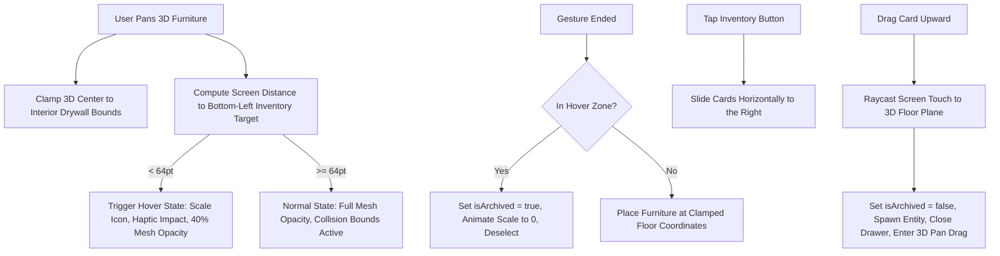

# ADR 0028: Studio 3D Inventory and Drag Archival System

## Context and Problem Statement
In 3D Studio rearrangement, users frequently need to experiment with spatial layouts by temporarily removing furniture from the room without permanently deleting it from the layout model. Furthermore, users require a tactile and intuitive mechanism to archive items by dragging them into an inventory zone, while preserving strict physical drywall collision boundaries (preventing items from clipping outside exterior room walls during the drag). Finally, users need an accessible sliding inventory tray to inspect archived furniture and restore items back into the room via direct 3D raycast drag.

## Decision Drivers
1. **Wall Clamping Integrity**: Furniture 3D position must remain strictly clamped to interior drywall boundaries during translation drag—items must never penetrate or clip through exterior walls.
2. **Screen-Space Touch Triage**: The inventory drop target is a 2D screen-space affordance at the bottom-left of the viewport. Touch tracking must compute screen-space Euclidean distance between the user's touch and the inventory target center to detect archive intent.
3. **Tactile Sensory Feedback**: Entering the archive hover zone must provide immediate visual (icon scale $1.18\times$, accent glow, furniture mesh opacity reduction) and sensory haptic feedback (`.impact(.medium)`).
4. **Fluid Restoration Lifecycle**: Archived items must slide out horizontally to the right of the inventory icon in glassmorphic cards displaying category iconography, name, and dimensions. Dragging an item card upward immediately raycasts onto the floor plane, dismisses the tray, and resumes interactive 3D translation.
5. **SwiftData Schema Compatibility**: The existing `Furniture.isArchived` Boolean property is used directly without requiring breaking database migrations or schema adjustments.

## Considered Options
1. **Screen-Space Target Proximity with 3D Raycast Drag**: Track 2D touch coordinates against the bottom-left inventory button. Clamp 3D entity inside drywall boundaries while detecting screen-space archive intent. Dragging cards from the tray raycasts to the floor and spawns the 3D entity seamlessly.
2. **Dedicated 3D Floor Wastebasket Entity**: Place an interactive 3D trash bin entity inside the room model where items must be physically collided. (Rejected: Clutters small room layouts and depends on camera angle/obstruction).
3. **Modal Sheet Inventory**: Open a standard bottom sheet to view archived items with a "Restore" button. (Rejected: Breaks tactile spatial presence and prevents direct drag-and-drop onto the floor).

## Decision Outcome
Chosen Option: **Option 1 (Screen-Space Target Proximity with 3D Raycast Drag)**.

### Architecture & Spatial Touch Flow

## Consequences

### Positive
- **Zero Schema Disruptions**: Operates entirely on the existing `Furniture.isArchived` property in SwiftData.
- **Physical Plausibility**: Furniture never visually escapes or clips through plaster drywall boundaries, adhering to architectural standards.
- **Natural Ergonomics**: Smooth transition between 2D drawer cards and 3D floor entities using unprojected raycasts.
- **Immediate Reversibility**: Users can archive and restore items instantaneously without modal dialogs or confirmation prompts.

### Negative / Trade-Offs
- Dragging upward from a 2D SwiftUI card requires coordinate space synchronization with the underlying `ARView` / `RoomSimulationView`.
- Camera angle changes in different viewport presets alter the visual distance between the floor and the bottom-left screen button, handled robustly via screen-space touch coordinates rather than world coordinates.
