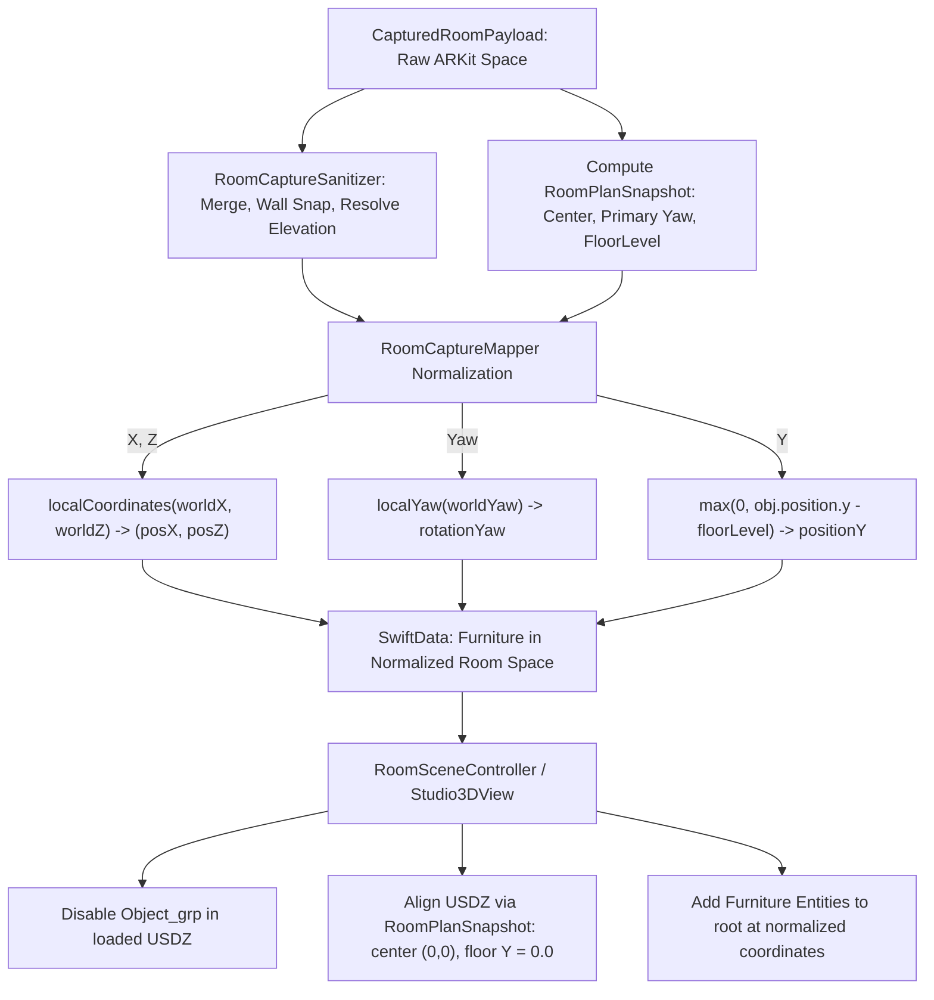

# ADR 0029: Scanned Room Furniture Coordinate Normalization and Static Mesh Suppression

## Context and Problem Statement
When capturing rooms via Apple RoomPlan LiDAR, all detected geometry (walls, apertures, furniture objects) is initially expressed in the ARKit world camera tracking coordinate frame. In real scans:
1. The floor plane is located at an arbitrary negative Y coordinate (`payload.floorLevel`, typically $-1.2\text{m}$ to $-1.7\text{m}$ relative to the initial camera pose).
2. The room's geometric centroid is offset from $(0, 0)$ along $X$ and $Z$, and the primary wall has an arbitrary orientation yaw tilt.
3. The exported `Room.usdz` asset bundles non-interactive static geometry meshes for all detected furniture under a child node named `Object_grp`.

Previously, while mock reference environments (`Room-2` and `MockRoom`) were pre-normalized, real LiDAR scans ingested through `RoomCaptureMapper` suffered from four compounding coordinate disconnects:
1. **Underground Spawning**: `RoomCaptureSanitizer` grounded furniture to `payload.floorLevel` (e.g. $-1.2\text{m}$), and `RoomCaptureMapper` stored this negative Y into `Furniture.positionY`. When `RoomSceneController` loaded the USDZ room mesh, it elevated the floor to $Y = 0.0$, but `populateFurnitures()` added furniture entities to the scene root at raw $Y \approx -1.2\text{m}$, placing all interactive furniture $>1\text{m}$ underground.
2. **Exterior Wall Penetration**: `RoomSceneController` straightened and centered the room mesh around $(0, 0)$, but furniture positions $(X, Z)$ remained in raw camera tracking coordinates. As a result, furniture spawned outside the exterior room walls.
3. **Baked Static USDZ Ghost Meshes**: `RoomSceneController.load()` did not disable `Object_grp` within the loaded RoomPlan USDZ asset. Baked static meshes remained visible inside the room while interactive boxes sat outside and underground.
4. **2D Orientation Double-Transformation Risk**: `OrientationView.swift` unconditionally applied `scanPlan?.localCoordinates(worldX:worldZ:)`. If furniture was already saved in normalized local coordinates, applying `localCoordinates` again double-shifted the item away from the room center.

## Decision Drivers
- **Normalized Canonical Coordinate Space**: All furniture in `Layout.furnitures` must be stored in room-local coordinates: centered at $(0, 0)$ horizontally, grounded at $Y = 0.0$ (or elevated above 0.0 for wall-mounted/supported items), with yaw aligned squarely with the primary wall axis.
- **Suppression of Baked USDZ Geometry**: Non-interactive static meshes in `Object_grp` must be disabled upon loading in `RoomSceneController.load()`, ensuring only user-interactive `Furniture` entities appear.
- **Zero-Friction Ingestion Pipeline**: `RoomCaptureMapper` must normalize furniture coordinates $(X, Z, Y, \text{yaw})$ at the point of ingestion using `RoomPlanSnapshot`.
- **Automatic In-Place Legacy Migration**: Legacy user scans created prior to this normalization (where `furniture.positionY < -0.3`) must automatically migrate to normalized room coordinates upon scene population in `RoomSceneController` and render correctly in `OrientationView`.

## Considered Options
1. **Container-level nesting for furniture entities**: Add furniture entities as children of `CaptureSpace` rather than `root`, relying on container transforms to shift furniture.
   - *Downside*: Clutters drag physics, raycasting, and boundary clamping in `SpatialClearanceEngine`, which operates directly in world coordinates with floor at $Y = 0.0$.
2. **Ingestion-time coordinate normalization with legacy migration**: Transform furniture coordinates at ingestion in `RoomCaptureMapper` using `RoomPlanSnapshot.localCoordinates`, ground floor to $Y = 0.0$, suppress `Object_grp` in `RoomSceneController.load()`, and provide legacy fallback checks (`positionY < -0.3`) in `populateFurnitures()` and `OrientationView`.
   - *Upside*: Establishes a single, unambiguous spatial invariant: all persistent furniture coordinates in SwiftData are centered at $(0, 0)$ with floor $Y = 0.0$. Simplifies 3D Studio drag, collision detection, and 2D orientation view.

## Decision Outcome
Chosen Option: **Option 2 (Ingestion-time coordinate normalization with legacy migration)**.

### Architectural Invariants & Transformation Pipeline

### Key Implementation Details:
1. **`RoomCaptureMapper.mapToRoom`**:
   - Generates `RoomPlanSnapshot` when walls are present.
   - For each sanitized furniture object:
     $$\mathbf{pos}_{XZ} = \text{snapshot.localCoordinates}(obj.position.x, obj.position.z)$$
     $$yaw = \text{snapshot.localYaw}(obj.rotationYaw)$$
     $$posY = \max(0.0, obj.position.y - payload.floorLevel)$$
2. **`RoomSceneController.load` & `Room3DRealityViewport`**:
   - Explicitly hides baked static furniture: `loaded.findEntity(named: "Object_grp")?.isEnabled = false`.
   - When `RoomPlanSnapshot` is present on the room, wraps `roomShell` in `captureSpace` aligned with $-snap.yawRadians$ and translated by $inverseYaw \cdot [-snap.centerX, -floorY, -snap.centerZ]$, bringing the USDZ floor to $Y = 0.0$ and origin to $(0, 0)$.
3. **`RoomSceneController.populateFurnitures`**:
   - Employs clustering-based camera-space detection (`dToSnapCenter < dToOrigin || positionY < -0.05`). Any unnormalized item (grounded or elevated wall shelves) is transformed into local coordinates in-place and clamped to $Y \ge 0.0$.
4. **`OrientationView.furnitureFootprint`**:
   - Only applies `scanPlan.localCoordinates` and `scanPlan.localYaw` if `item.positionY < -0.3`. For normalized items ($positionY \ge -0.3$), uses $(item.positionX, item.positionZ)$ directly.

## Consequences

### Positive
- **Visual Accuracy**: All scanned furniture sits grounded on the floor ($Y = 0.0$) and inside interior plaster walls with zero visual clipping or underground spawning.
- **No Duplicate Ghost Meshes**: Disabling `Object_grp` eliminates non-interactive baked USDZ duplicates.
- **Consistent Physics & Clamping**: `SpatialClearanceEngine` and touch dragging operate cleanly in $(0, 0)$-centered space.
- **Non-Destructive Backward Compatibility**: Existing user layouts are migrated transparently on load.

### Negative / Trade-Offs
- Real RoomPlan scans that lack wall detections (`walls.isEmpty`) fall back to camera-centered coordinates grounded at $Y = 0.0$.
