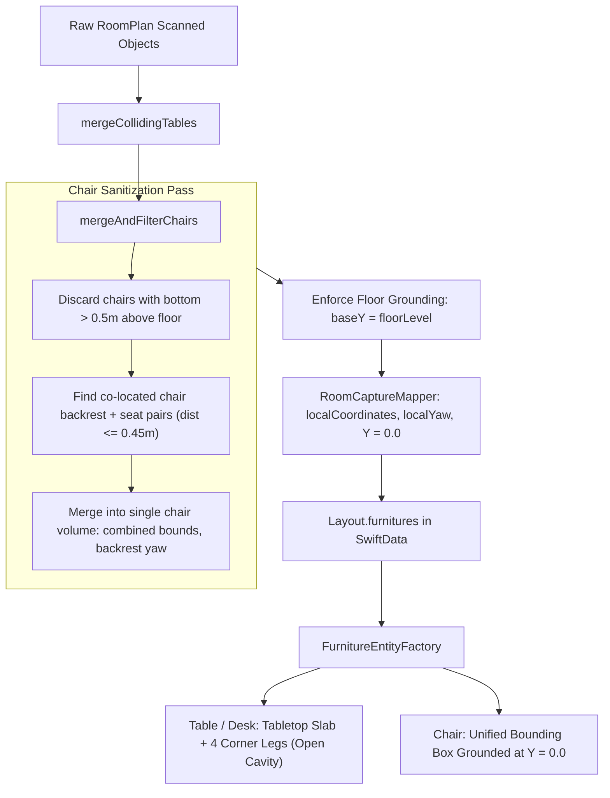

# ADR 0030: Scanned Chair Component Merging, Airborne Artifact Filtering, and Procedural Under-Table Clearance

## Context and Problem Statement
When scanning furnished rooms with Apple RoomPlan LiDAR, two distinct spatial pipeline defects occur in conference and office spaces:
1. **Split-Box Chair Detections**: Office chairs tucked under conference tables are frequently detected as two separate bounding boxes: one for the backrest on the floor, and one for the seat cushion/armrests at table height. This inflates the inventory count (e.g. 18 items for 7 chairs and 1 table) and creates visual clipping where seat cushions protrude through table geometry.
2. **Airborne Wall Artifacts**: Wall-mounted items (whiteboards, acoustic soundproofing panels, wall monitors) lack dedicated categories in RoomPlan's 16-category taxonomy. RoomPlan misclassifies them as `chair` or `storage` hanging $\approx 1.5\text{m}$ in mid-air on the drywall.
3. **Solid Block Furniture Rendering**: Procedural fallback geometry in `FurnitureEntityFactory` rendered tables and desks as solid monolithic cubes. Tucked chairs could not nest under tabletop surfaces without colliding into solid table meshes.
4. **Studio 3D Simulation Coordinate Bifurcation**: In `RoomSceneController.loadScannedLayout`, items were placed into `captureSpace` or `normalizedRoom` using a threshold of `item.position.y >= -0.3`, which skipped coordinate migration for legacy scans and left elevated items misaligned.

## Decision Drivers
- **Physical Plausibility & Seating Invariant**: Seating (`chair`, `sofa`) must always ground to the floor plane ($Y = 0.0$ in room-local coordinates) and never float in mid-air or snap onto table surfaces.
- **Deduplication of Fragmented Detections**: Proximity-paired chair components (backrest + seat cushion) must be merged into a single unified chair entity.
- **Airborne Artifact Suppression**: Discard spurious floating chair detections positioned $> 0.50\text{m}$ above the floor that lack ground contact.
- **Procedural Under-Table Legroom**: Tables and desks must feature an open legroom cavity with a tabletop slab and corner legs so nested chairs fit naturally.
- **Unified 3D Studio Simulation Space**: `RoomSceneController.loadScannedLayout` must migrate legacy camera-space coordinates into $(0, 0)$-centered, floor-leveled space.

## Considered Options
1. **Raw Ingestion with Manual User Clean-Up**:
   - Keep all raw RoomPlan bounding boxes as-is and require the user to delete duplicate seat cushions and floating wall chairs in 3D Studio.
   - *Downside*: Degrades first-run experience; rooms look broken upon scan completion.
2. **Sanitizer Pipeline Chair Merging, Artifact Filtering, and Open Table Modeling**:
   - Implement a chair pre-pass in `RoomCaptureSanitizer` to discard airborne wall artifacts and merge co-located backrest/seat pairs.
   - Model procedural tables and desks in `FurnitureEntityFactory` with a tabletop slab and 4 corner legs.
   - Migrate legacy furnishings in `loadScannedLayout` to $(0, 0)$ floor level.
   - *Upside*: Fully automated, zero visual clutter, physically accurate layouts matching real-world conference setups.

## Decision Outcome
Chosen Option: **Option 2 (Sanitizer Pipeline Chair Merging, Artifact Filtering, and Open Table Modeling)**.

### Architectural Pipeline

### Key Implementation Details:
1. **`RoomCaptureSanitizer.mergeAndFilterChairs`**:
   - Filters out any `chair` object whose bottom elevation above `floorLevel` exceeds $0.50\text{m}$ unless adjacent to a ground-connected chair.
   - Merges co-located chair components within $0.45\text{m}$ horizontal distance and $0.30\text{m}$ vertical gap into a single unified chair volume.
2. **`RoomCaptureSanitizer.resolveElevation`**:
   - Enforces that chairs and sofas never elevate onto table surfaces or walls; always returns `baseY = floorLevel`.
3. **`FurnitureEntityFactory.createEntity`**:
   - For `table` and `desk` categories (with height $\ge 0.50\text{m}$ and min dimension $\ge 0.60\text{m}$), creates an open architectural table comprising a tabletop slab and 4 perimeter corner legs, allowing nested chairs to sit naturally under the tabletop.
4. **`RoomSceneController.loadScannedLayout`**:
   - Migrates legacy camera-tracking furnishings to normalized room coordinates and adds all entities directly to `normalizedRoom` at $Y \ge 0.0$.

## Consequences

### Positive
- **Clean Conference Scans**: 7-chair meeting rooms produce exactly 7 grounded chairs and 1 table instead of 18 floating/split artifacts.
- **No Wall-Floating Chairs**: Whiteboards and acoustic panels misclassified as chairs do not clutter the drywall.
- **Natural Under-Table Clearance**: Tucked chairs nest cleanly under tabletop surfaces without colliding into solid wooden cubes.
- **Consistent Simulation Space**: All lighting, shadows, and touch interactions operate in a unified coordinate frame.

### Negative / Trade-Offs
- Real floating chairs (e.g. specialized hanging swing chairs) would be filtered out by the $> 0.50\text{m}$ airborne rule and must be placed manually via inventory.
