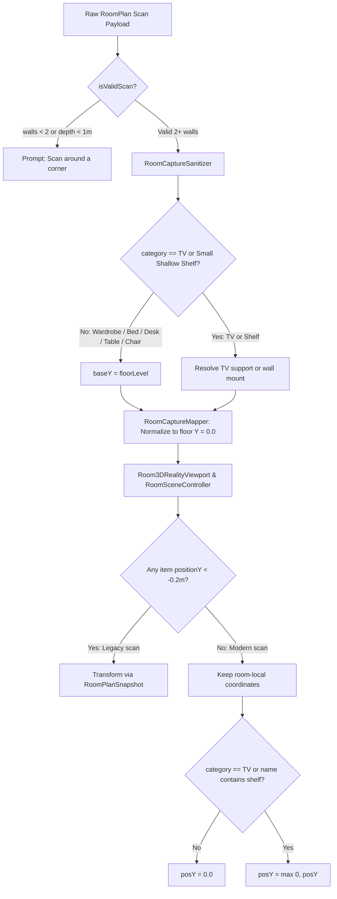

# ADR 0043: Universal Furniture Floor Grounding, Strict Wall Shelf Elevation, and Deterministic Legacy Migration

* Status: accepted
* Date: 2026-11-02
* Deciders: verzional, antigravity

## Context and Problem Statement
When scanning furnished rooms with Apple RoomPlan LiDAR, users reported that full-sized wardrobes and storage furniture floated $1.0\text{m}$ to $1.5\text{m}$ in mid-air in both `Room3DRealityViewport` (scan preview) and `RoomSceneController` (3D Studio). Investigation revealed three compounding defects in the spatial ingestion and rendering pipeline:

1. **Flawed Proximity-Based Legacy Migration Heuristic**:
   In `Room3DRealityViewport` and `RoomSceneController`, legacy coordinate migration employed a geometric proximity heuristic:
   ```swift
   let isCloserToSnapCenter = (abs(snap.centerX) > 0.2 || abs(snap.centerZ) > 0.2) && (dToSnapCenter + 0.3 < dToOrigin)
   ```
   When user rooms had an offset tracking centroid, any furniture placed in the quadrant near $(snap.centerX, snap.centerZ)$ matched this heuristic—even though its coordinates had already been normalized by `RoomCaptureMapper`. As a result, `localCoordinates` was applied twice and `posY - floorLvl` was re-applied, levitating already-normalized furniture by $-(-1.4\text{m}) = +1.4\text{m}$ into mid-air.
2. **Overly Permissive Closet Elevation in Sanitizer**:
   `RoomCaptureSanitizer.resolveElevation` treated all objects mapped to `"closet"` as eligible for shelf elevation or furniture stacking. When RoomPlan detected a tall wardrobe with bounding box bottom $> 0.25\text{m}$ above the estimated floor plane or adjacent to a desk, the sanitizer elevated the entire wardrobe atop the desk or marked it as a floating wall shelf.
3. **Incomplete Grounding Invariant in RealityKit Viewports**:
   `Room3DRealityViewport` and `RoomSceneController` explicitly hardcoded floor grounding (`posY = 0.0`) only for `chair` and `sofa`, leaving wardrobes, desks, tables, and beds vulnerable to spurious elevated values.
4. **Single-Wall Collapsed Sliver Rooms**:
   `RoomScanViewModel.isValidScan` only checked `!payload.walls.isEmpty && payload.roomWidth >= 0.5`. Scanning a single continuous wall produced an artificial $0.65\text{m} \times 5.61\text{m}$ corridor sliver instead of enforcing a multi-wall enclosed room.

## Decision Drivers
- **Universal Physical Floor-Grounding Invariant**: In authentic home interior spaces, heavy floor furniture (wardrobes, cabinets, media consoles, beds, sofas, chairs, tables, desks, fireplaces) must rest flush on the floor at $Y = 0.0$. Only televisions and small, shallow floating wall shelves may sit elevated.
- **Deterministic Legacy Migration**: Layouts already stored in normalized room-local coordinates must never be re-transformed. Legacy migration must trigger strictly on the presence of unmigrated negative-Y floor coordinates (`positionY < -0.2`).
- **Enclosed Room Scan Quality Gate**: Single-wall scans must be rejected at the capture gate, prompting the user to scan around at least one corner (`walls.count >= 2` and depth $\ge 1.0\text{m}$).

## Considered Options
1. **Per-Category Ad-Hoc Clamping**:
   - Patch `chair`, `sofa`, and `wardrobe` individually across each viewport.
   - *Downside*: Fragile; any new furniture category (e.g. dressers, side tables, beds) remains prone to floating.
2. **Pipeline-Wide Floor Grounding with Deterministic Legacy Detection**:
   - Restrict `resolveElevation` in `RoomCaptureSanitizer` so only small shallow items (`dimensions.y <= 0.60` and depth $\le 0.45\text{m}$) qualify as wall shelves.
   - Ground all non-shelf/non-TV furniture to $Y = 0.0$ in `Room3DRealityViewport` and `RoomSceneController`.
   - Gate legacy coordinate migration on `layout.furnitures.contains(where: { $0.positionY < -0.2 })`.
   - Require `payload.walls.count >= 2 && min(payload.roomWidth, payload.roomLength) >= 1.0` in `isValidScan`.
   - *Upside*: Eliminates all floating furniture bugs across both previews and 3D Studio, prevents single-wall room collapse, and maintains backward compatibility with legacy unmigrated scans.

## Decision Outcome
Chosen Option: **Option 2 (Pipeline-Wide Floor Grounding with Deterministic Legacy Detection)**.

### Architectural Pipeline



## Consequences

### Positive
- **No Floating Wardrobes or Desks**: All heavy floor furniture sits flush on the floor surface ($Y = 0.0$).
- **No Coordinate Levitation**: Deterministic legacy detection prevents modern normalized layouts from having `localCoordinates` and `floorLevel` offsets re-applied.
- **Accurate Room Geometry**: Incomplete single-wall scans are caught immediately, preventing squished sliver rooms.
- **Fast Test Execution**: Headless test suite runner bypasses unneeded foundation model timeouts.

### Negative
- Users scanning only a single feature wall must scan around at least one corner before saving.
